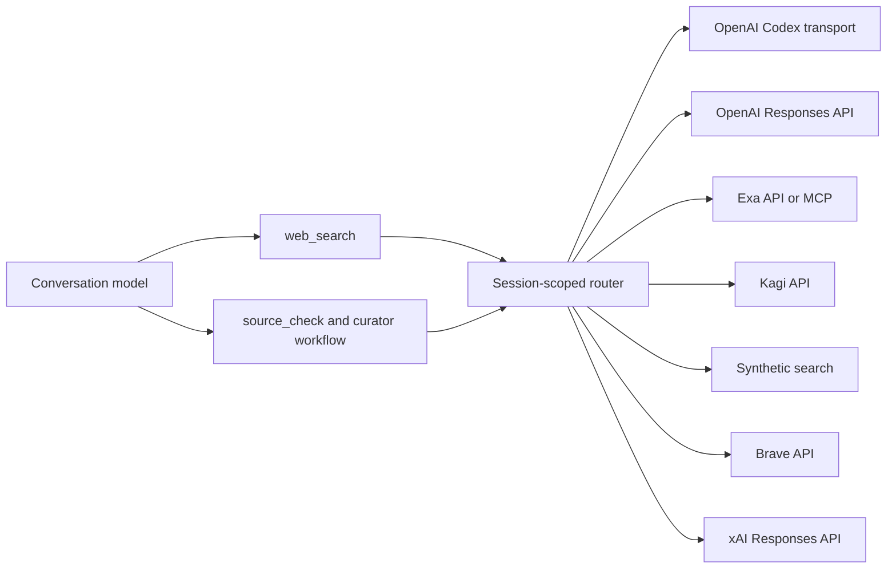

# Web search

[한국어](../ko/web-search.md)

In the integrated profile, choco-pi gives the model a single `web_search` tool. This page covers how that tool chooses a search backend, how it falls back, how credentials and billing work, and what it stores. The conversation model does not choose or authenticate the search service: an Anthropic, Synthetic, or other conversation can use an OpenAI, Exa, Kagi, Synthetic, Brave, or xAI search backend that is configured separately.

`web_search` is deferred, so find it with `tool_search` when it is not already visible. Page extraction and `agent_browser` remain separate tools, for reading a result or interacting with a site.

## Architecture



The OpenAI Codex and OpenAI Responses routes are separate transports within the same `openai` family. Each result names the backend and transport that produced it. References returned by one session or transport cannot be reused in another.

## Provider selection and precedence

A request's `provider` field takes precedence over all other routing. It accepts `auto`, `all`, one family, or a non-empty list of families. The public families are `openai`, `exa`, `kagi`, `synthetic`, `brave`, and `xai`. An explicit list of families and `all` fan out: they query every listed provider. `searchRouting.providers`, by contrast, is an ordered fallback sequence and does not fan out.

When a request does not override the provider, `web-search.json` can set either a fixed `searchProvider` (the legacy `provider` key is also accepted) or `searchRouting`. Setting both is an error. This check is a deliberate breaking change: if your configuration contains both `searchProvider`/`provider` and `searchRouting`, remove `searchRouting` to keep the old fixed provider, or remove the fixed provider key to use ordered routing.

If neither is configured, automatic routing prefers families in this order:

1. OpenAI
2. Exa
3. Kagi
4. Synthetic
5. Brave

Within that order, which backend is actually tried depends on adapter availability, the capabilities the request needs, and transport priority. Synthetic search is never enabled automatically; its own extension setting and entitlement still apply.

The configuration file is `$PI_CODING_AGENT_DIR/web-search.json` when `PI_CODING_AGENT_DIR` is set, `$XDG_CONFIG_HOME/pi/web-search.json` when only `XDG_CONFIG_HOME` is set, and `~/.pi/web-search.json` otherwise. The standalone `choco-pi` launcher always sets `PI_CODING_AGENT_DIR`, so there the file is `$CHOCO_PI_HOME/agent/web-search.json` (by default `~/.choco-pi/agent/web-search.json`), and the XDG and `~/.pi` fallbacks never apply. For example:

```json
{
  "searchRouting": {
    "providers": ["openai", "exa", "kagi"],
    "fallbackOn": ["transient", "network", "invalid-response"]
  },
  "allowBilledApiFallback": false
}
```

Each adapter resolves its own credentials from the sources its package supports: Pi's credential registry, configuration, environment variables, or proxy settings. The conversation provider's key is never forwarded to another provider. Provider-specific settings, such as Brave's locale, pagination, freshness, and safe search, or Exa's search mode, are constraints on the request, not hints.

Besides ordinary queries, the canonical tool supports image search and navigation actions when the selected transport advertises them. `open` accepts a URL or a reference returned in the same session; `click` and `find` work on a reference from the same session; and `lineno` can select a location on transports that support it. A navigation action that the transport does not support fails instead of silently switching providers.

## xAI (Grok) search

The `xai` family is explicit-only: automatic routing and `all` never use it. It runs only when a request's `provider` (a single family or a list of families) or `searchRouting.providers` names `xai`. Every call is billed by xAI, which is why it is never chosen automatically.

Its adapter is registered only while Pi's model registry reports configured `xai` credentials, from `/login xai` (OAuth) or `XAI_API_KEY`. If you sign in during a session, the adapter is picked up at the next session start, tree navigation, or model selection. Each search sends one Responses request with the `web_search` tool to `grok-4.3` at the `xai` provider's base URL and returns the cited sources. Domain filters accept up to five allowed domains or up to five excluded domains, never both in one request.

## Fallback, errors, and billing

Fallback stays within the configured providers and deadlines. By default, the core allows 120 seconds per attempt and 360 seconds in total. Each backend's own limits still apply, and callers of the core API can override either deadline explicitly. An automatic candidate without credentials is treated as unavailable. Authentication, configuration, invalid-request, entitlement, cancellation, stale-session, and conflict errors stop routing. Empty but valid search results count as success. Fallback on a quota error happens only when it is explicitly enabled and the adapter marks the failure as retryable.

When a subscription transport fails during automatic or configured routing, the search does not fall through to a billed API transport later in the same sequence unless `allowBilledApiFallback` is `true`. This guard follows the resolved billing mode across provider families. A subscription that is unavailable or not configured does not trigger it, and a free transport remains eligible. The guard also does not disable an API-only provider that is selected as the first available route.

Explicit selection works differently. A single explicit provider is a fresh selection. An explicit list of providers, or `all`, is a deliberate fan-out in which each provider runs independently, so a subscription failure on one selected provider does not block another selected provider's API transport. An explicit selection never silently switches to a different family.

Error messages list the backends that were tried and never include credentials. Cancellation stops the current transport and prevents any further fallback attempt.

## Privacy and storage

Queries and the filters you enable are sent to the selected backend. Page extraction may then contact the result URLs. A direct page fetch connects only to DNS addresses that passed the private-network check, and each redirect is checked again. Review each provider's privacy and billing terms before you enable it, and keep secrets out of queries.

Search results can be stored in the current Pi session, so that `get_search_content`, source checking, and curator workflows can retrieve them. Provider results stored in the legacy format remain readable. Search references belong to their session and are not accepted in another one.

## Standalone compatibility

Here "standalone" means a search package loaded on its own, not the standalone `choco-pi` command. Loaded without the canonical core package, each search package keeps its legacy tool behavior.

In the integrated profile, `choco-pi-web-access` must come immediately after `choco-pi-web-search` in `settings.json`, before the other backend packages. The canonical `web_search` tool activates only after the core requests integration and web-access actually registers `web_search`; if that frontend is missing or disabled, the legacy search tools stay available. Once activation succeeds, legacy names such as `web_run`, `web__run`, `synthetic_web_search`, and `agent_browser_web_search` are left out of discovery and Code Mode in favor of `web_search`.

The profile's automated tests mock the transport boundaries. They verify routing and credential isolation, not live provider entitlement, remote availability, result quality, or current pricing.
