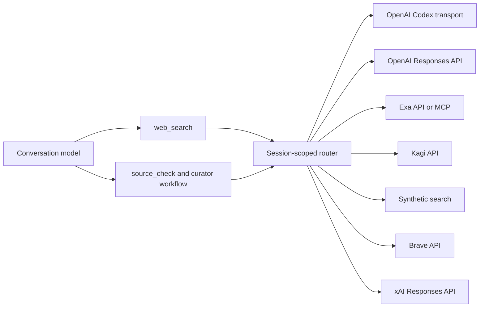

# 웹 검색

[English](../en/web-search.md)

통합 프로필에서 choco-pi가 모델에 제공하는 웹 검색 도구는 `web_search` 하나입니다. 이 페이지는 이 도구가 검색 백엔드를 고르는 방식, fallback 동작, 인증 정보와 요금, 저장하는 내용을 설명합니다. 검색 서비스를 고르고 인증하는 일은 대화 모델과 무관합니다. 그래서 Anthropic, Synthetic을 비롯해 어떤 모델로 대화하든, 따로 설정해 둔 OpenAI, Exa, Kagi, Synthetic, Brave, xAI 검색 백엔드를 쓸 수 있습니다.

`web_search`는 지연 로딩되는 도구이므로, 목록에 보이지 않으면 `tool_search`로 찾으세요. 검색 결과 페이지를 읽는 추출 도구와 사이트를 조작하는 `agent_browser`는 지금처럼 별도 도구로 남아 있습니다.

## 아키텍처



OpenAI Codex 경로와 OpenAI Responses 경로는 같은 `openai` 계열에 속하지만 전송 방식이 다릅니다. 결과마다 그 결과를 만든 백엔드와 전송 방식이 표시됩니다. 한 세션이나 전송 방식에서 받은 참조는 다른 세션이나 전송 방식에서 다시 쓸 수 없습니다.

## 공급자 선택과 우선순위

라우팅에서 가장 우선하는 것은 요청의 `provider` 필드입니다. 이 필드에는 `auto`, `all`, 계열 하나, 또는 비어 있지 않은 계열 목록을 넣을 수 있습니다. 공개된 계열은 `openai`, `exa`, `kagi`, `synthetic`, `brave`, `google`, `xai`입니다. 계열 목록을 명시하거나 `all`을 쓰면 나열된 공급자 모두에 동시에 요청합니다(fan out). 반면 `searchRouting.providers`는 순서대로 하나씩 시도하는 fallback 목록이며, 동시에 요청하지 않습니다.

요청에서 공급자를 지정하지 않았다면 `web-search.json`에 고정 공급자 `searchProvider`(예전 키인 `provider`도 허용)와 `searchRouting` 중 하나를 설정할 수 있습니다. 둘 다 설정하면 오류입니다. 이 검사는 의도적으로 하위 호환성을 깬 부분입니다. 지금 설정에 `searchProvider`/`provider`와 `searchRouting`이 모두 있다면, 기존 고정 공급자를 계속 쓰려면 `searchRouting`을 지우고, 순서대로 시도하는 라우팅을 쓰려면 고정 공급자 키를 지우세요.

둘 다 설정하지 않으면 자동 라우팅이 다음 순서로 계열을 고릅니다.

1. OpenAI
2. Exa
3. Kagi
4. Synthetic
5. Brave

이 순서 안에서 실제로 어떤 백엔드를 시도할지는 어댑터를 쓸 수 있는지, 요청에 필요한 기능을 지원하는지, 전송 방식 우선순위가 어떤지에 따라 정해집니다. Synthetic 검색은 자동으로 켜지지 않으며, Synthetic 확장 자체의 설정과 사용 권한(entitlement) 조건도 그대로 적용됩니다.

설정 파일 위치는 환경 변수에 따라 다릅니다. `PI_CODING_AGENT_DIR`이 설정되어 있으면 `$PI_CODING_AGENT_DIR/web-search.json`, `XDG_CONFIG_HOME`만 설정되어 있으면 `$XDG_CONFIG_HOME/pi/web-search.json`, 둘 다 없으면 `~/.pi/web-search.json`입니다. 독립 실행형 `choco-pi` 실행기는 항상 `PI_CODING_AGENT_DIR`을 설정하므로, 이때 설정 파일은 `$CHOCO_PI_HOME/agent/web-search.json`(기본값 `~/.choco-pi/agent/web-search.json`)이고 XDG 경로와 `~/.pi` 경로는 쓰이지 않습니다. 설정 예시는 다음과 같습니다.

```json
{
  "searchRouting": {
    "providers": ["openai", "exa", "kagi"],
    "fallbackOn": ["transient", "network", "invalid-response"]
  },
  "allowBilledApiFallback": false
}
```

각 어댑터는 자기 패키지가 지원하는 곳에서 인증 정보를 직접 찾습니다. Pi 인증 정보 레지스트리, 설정, 환경 변수, 프록시 설정이 그런 곳입니다. 대화 공급자의 키는 다른 공급자에 절대 넘기지 않습니다. Brave의 locale, 페이지 나누기, 최신성(freshness), safe search나 Exa의 검색 모드 같은 공급자별 설정은 참고용 힌트가 아니라 요청이 지켜야 할 조건으로 적용됩니다.

일반 검색 외에도, 선택된 전송 방식이 지원한다고 알리면 정식 도구로 이미지 검색과 탐색 동작을 쓸 수 있습니다. `open`은 URL이나 같은 세션에서 받은 참조를 받고, `click`과 `find`는 같은 세션의 참조를 대상으로 동작합니다. 지원하는 전송 방식에서는 `lineno`로 위치를 지정할 수도 있습니다. 전송 방식이 지원하지 않는 탐색 동작을 요청하면 몰래 다른 공급자로 바꾸지 않고 실패합니다.

## xAI (Grok) 검색

`xai` 계열은 명시적으로 지정해야만 씁니다. 자동 라우팅과 `all`은 이 계열을 쓰지 않으며, 요청의 `provider`(계열 하나 또는 계열 목록)나 `searchRouting.providers`에 `xai`가 들어 있을 때만 실행됩니다. 호출할 때마다 xAI 요금이 부과되므로 자동으로 선택되는 일은 없습니다.

이 어댑터는 Pi 모델 레지스트리에 `xai` 인증 정보가 설정되어 있을 때만 등록됩니다. 인증 정보는 `/login xai`(OAuth)나 `XAI_API_KEY`로 설정합니다. 세션 도중에 로그인하면 다음에 세션을 시작하거나, 트리를 탐색하거나, 모델을 고를 때 어댑터가 등록됩니다. 검색할 때마다 `xai` 공급자 base URL의 `grok-4.3`에 `web_search` 도구를 포함한 Responses 요청을 한 번 보내고, 인용된 출처를 돌려줍니다. 도메인 필터에는 허용할 도메인을 최대 다섯 개, 또는 제외할 도메인을 최대 다섯 개 지정할 수 있으며, 한 요청에서 둘을 함께 쓸 수는 없습니다.

## Google 검색 (Antigravity)

`google` 계열도 `xai`처럼 명시적으로 지정해야만 씁니다. 자동 라우팅과 `all`은 이 계열을 쓰지 않으며, 요청의 `provider`나 `searchRouting.providers`에 `google`이 들어 있을 때만 실행됩니다. 호출할 때마다 Google Antigravity 구독 할당량을 쓰고, 이 사용에는 Google의 Antigravity 서비스 약관이 적용되므로 자동으로 선택되는 일은 없습니다.

이 어댑터는 정식 통합 검색 안에서만, 그리고 `google` 공급자에 저장된 Google Antigravity 로그인(`/login google` 후 Google Antigravity 선택)이 Pi에 있을 때만 등록됩니다. 저장된 Gemini API 키나 `GEMINI_API_KEY`는 여기에 해당하지 않습니다. 세션 도중에 로그인하면 다음에 세션을 시작하거나, 트리를 탐색하거나, 모델을 고를 때 반영됩니다. 검색할 때마다 카탈로그의 웹 검색 모델(카탈로그에 없으면 `gemini-3.5-flash-lite`)에 Google Search 도구를 포함한 Cloud Code Assist `generateContent` 요청을 한 번 보내고, 번호가 붙은 인용과 Google이 준 그대로의 출처 링크를 함께 돌려줍니다. 허용·제외 도메인과 최신성 필터는 지원하지만 URL 열기는 지원하지 않습니다. 자세한 내용과 아직 검증되지 않은 가정은 `packages/choco-pi-provider-google-antigravity/docs/search.md`에 있습니다.

## Fallback, 오류, 요금

fallback은 설정된 공급자와 기한 안에서만 일어납니다. 코어의 기본 기한은 시도당 120초, 전체 360초입니다. 백엔드 자체의 한도도 그대로 적용되며, 코어 API를 호출하는 쪽에서 두 기한을 각각 직접 바꿀 수 있습니다. 인증 정보가 없는 자동 후보는 쓸 수 없는 것으로 봅니다. 인증, 설정, 잘못된 요청, 사용 권한, 취소, 유효하지 않은 세션, 충돌 오류가 나면 라우팅을 멈춥니다. 결과가 비어 있어도 응답이 올바르면 성공으로 칩니다. 할당량 오류에 따른 fallback은 명시적으로 켜야 하며, 어댑터가 그 실패를 재시도할 수 있다고 표시한 경우에만 일어납니다.

자동 라우팅이나 설정된 라우팅에서 구독 전송 방식이 실패해도, 같은 순서에서 뒤에 있는 유료 API 전송 방식으로 넘어가지 않습니다. 넘어가게 하려면 `allowBilledApiFallback`을 `true`로 설정해야 합니다. 이 보호 장치는 공급자 계열이 아니라 실제로 정해진 요금 방식을 기준으로 동작하므로, 계열이 달라도 똑같이 적용됩니다. 구독을 쓸 수 없거나 설정하지 않았다면 이 장치는 작동하지 않으며, 무료 전송 방식은 계속 후보로 남습니다. 처음으로 쓸 수 있는 경로로 선택된 API 전용 공급자도 막지 않습니다.

공급자를 명시적으로 선택했다면 다르게 동작합니다. 공급자 하나를 명시하면 새로 선택한 것으로 봅니다. 공급자 목록이나 `all`을 명시하면 공급자마다 독립적으로 실행되도록 의도적으로 동시에 요청하는 것으로 봅니다. 그래서 선택한 공급자 하나의 구독이 실패해도, 함께 선택한 다른 공급자의 API 전송 방식은 막히지 않습니다. 명시적으로 선택했을 때는 몰래 다른 계열로 넘어가는 일이 없습니다.

오류 메시지에는 시도한 백엔드가 표시되지만 인증 정보는 담기지 않습니다. 취소하면 진행 중인 전송을 멈추고, 이후 fallback도 시도하지 않습니다.

## 개인정보 보호와 저장

검색어와 켜 둔 필터는 선택된 백엔드로 전송됩니다. 그 뒤 페이지를 추출하는 과정에서 결과 URL에 접속할 수 있습니다. 페이지를 직접 가져올 때는 사설 네트워크 검사를 통과한 DNS 주소로만 연결하며, 리디렉션될 때마다 다시 검사합니다. 공급자를 켜기 전에 각 공급자의 개인정보 처리 방침과 요금 조건을 확인하고, 검색어에 비밀 정보를 넣지 마세요.

검색 결과는 현재 Pi 세션에 저장될 수 있으며, `get_search_content`, 출처 검증, curator 작업 절차가 저장된 결과를 다시 불러와 씁니다. 예전 형식으로 저장한 공급자 결과도 계속 읽을 수 있습니다. 검색 참조는 그것을 만든 세션에 속하므로 다른 세션에서는 받아들이지 않습니다.

## 패키지 단독 사용 시 호환성

여기서 단독 사용이란 검색 패키지 하나만 따로 불러온 경우를 말하며, 독립 실행형 `choco-pi` 명령과는 관계가 없습니다. 정식 코어 패키지 없이 불러온 검색 패키지는 예전 도구 동작을 그대로 유지합니다.

통합 프로필에서는 `settings.json`에서 `choco-pi-web-search` 바로 다음에 `choco-pi-web-access`가 와야 하고, 두 패키지가 다른 백엔드 패키지보다 앞에 있어야 합니다. 정식 `web_search` 도구는 코어가 통합을 요청하고 web-access가 실제로 `web_search`를 등록한 뒤에야 활성화됩니다. 따라서 이 프런트엔드 패키지가 없거나 꺼져 있으면 예전 검색 도구를 계속 쓸 수 있습니다. 활성화에 성공하면 `web_run`, `web__run`, `synthetic_web_search`, `agent_browser_web_search` 같은 예전 이름은 도구 검색과 Code Mode에서 빠지고, 그 자리를 `web_search`가 대신합니다.

프로필의 자동 테스트는 전송 경계를 mock으로 대체합니다. 따라서 라우팅과 인증 정보 격리는 검증하지만, 실제 공급자 사용 권한, 원격 서비스 가용성, 결과 품질, 현재 가격은 검증하지 않습니다.
